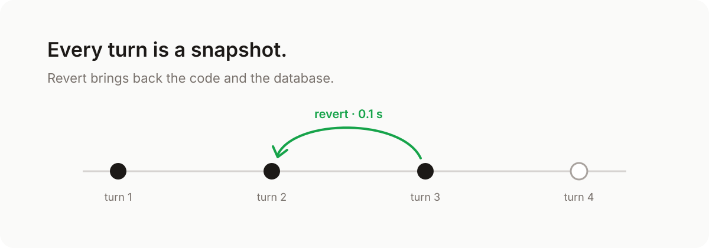
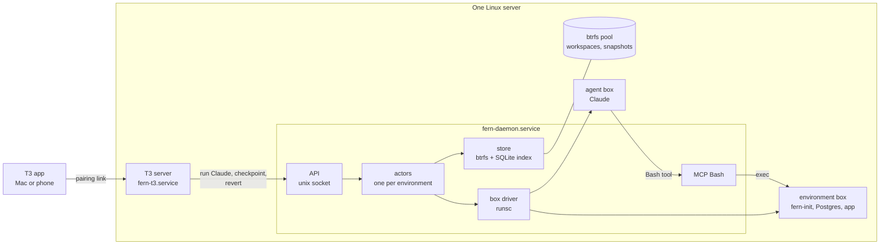
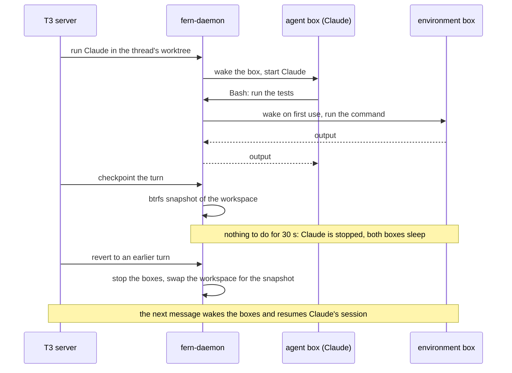
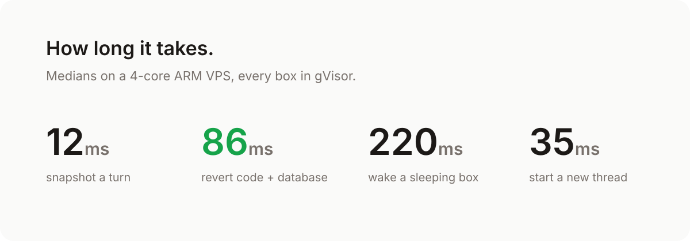
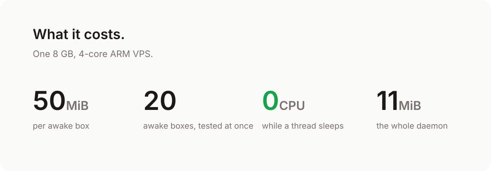

# Fern

[](https://github.com/nebler/fern/actions/workflows/ci.yml)
[](https://scorecard.dev/viewer/?uri=github.com/nebler/fern)


[](LICENSE)

**Give every AI coding thread its own environment that behaves like git for everything: code, dependencies and the running database.**



Fern runs behind [T3 Code](https://github.com/pingdotgg/t3code). Each thread gets a sandboxed box with its own copy of the repository and its services (such as Postgres or a Vite dev server). Every agent turn is snapshotted, so reverting a thread in T3 brings back the files *and* the database as they were. Idle boxes sleep and wake on the next message, or when someone opens the thread's preview. Claude runs as the real `claude` CLI on your own subscription: no API keys.

**What a thread gets:**
- **Undo for everything.** A btrfs snapshot per turn (12 ms); a revert puts back files and Postgres together (about 0.1 s).
- **A head start.** A new thread starts from the repository's golden snapshot in 35 ms, with its pinned tools (Node, pnpm, … through [mise](https://mise.jdx.dev)), `node_modules` and its initialised database.
- **Web development.** Dev servers Claude starts keep running; they hear Claude's edits; `http://<thread>.localhost:30780/` is a preview that wakes the box and reloads by itself (edit to page: 0.4 s).
- **Sleep when idle.** 30 s after a turn, Claude is stopped and both boxes sleep: no CPU until the next message.

## How it works



- **The daemon** (`fern-daemon`) owns the environments. Each one has an **actor**, a goroutine that makes its changes one at a time, counts the commands running in its boxes and puts them to sleep when idle.
- **The store** keeps each workspace as a btrfs subvolume. A snapshot is a btrfs snapshot (milliseconds, no copy), and a revert swaps the workspace for a copy of one in a single atomic rename. SQLite is only the index: the disk is the truth.
- **Boxes** are [gVisor](https://gvisor.dev) sandboxes the daemon starts itself with `runsc`, each with its own network namespace, an nftables firewall (internet only) and cgroup limits. Claude runs in an **agent box** of its own; its shell commands go through the daemon to the **environment box**, where the services are. The environment box never sees Claude's login.
- **Golden snapshots** hold a repository's built setup (its pinned tools, installed dependencies, an initialised database), so a new thread starts from one instead of running setup again.
- **The front door** (`:30780`) serves each box's ports as previews by host name, waking an asleep box; a request in progress, such as a live reload's WebSocket, keeps it awake. A fanotify watch on the host passes Claude's edits on to the dev servers in the environment's box, which gVisor would otherwise hide from them.

A turn, end to end:



## Benchmarks




On a Hetzner CAX21 VPS (4 ARM cores, 8 GB), gVisor, medians:

| | time | CPU |
|---|---:|---:|
| snapshot a turn | 12 ms | 20 ms |
| revert (files and database) | 86 ms | 140 ms |
| wake a box | 220 ms | 330 ms |
| put a box to sleep | 71 ms | 130 ms |
| run a command in an awake box | 19 ms | |
| new thread from a golden snapshot | 35 ms | |
| Claude's edit to a reloaded preview | 416 ms | |
| a whole short agent turn | | 7.3 s |

Memory: 16 MiB for an awake box with Postgres idle, 10.8 MiB for the daemon. An idle box sleeps 30 s after a turn and then uses no CPU.

Against the first design (agent-sandbox pods on Kubernetes): 8.7× less CPU per turn, revert 9.6× faster, 20 boxes woken at once 25 s → 1.2 s.

Still slow: a heavy dev server's first page. TanStack Start takes 16.6 s from an asleep box, 4.6 s under runc: gVisor without KVM costs about twice the CPU.

How each number was measured: [`lab/RESULTS.md`](lab/RESULTS.md).

## Engineering

- **Crash-safe by construction.** Every multi-step change leaves the disk showing how far it got (a marker file, a copy beside the workspace, a snapshot without its row), and `Reconcile` finishes or clears it on start. Crash tests stop each change at every one of its steps, on a real btrfs filesystem in CI.
- **Actors, tested with a fake clock.** One goroutine per environment, talked to through its mailbox. Idle sleeps, pre-wakes and concurrent changes are tested in `testing/synctest` bubbles, with `goleak` checking for leaked goroutines.
- **Performance is gated.** `lab/perf.sh` fails a change that makes any of its 288 metrics worse than the baseline (time, CPU, memory, disk and network). `lab/ab.sh` runs two versions in alternation on the same machine and gives each metric's change with a 95% interval and a p-value. `lab/profile.sh` traces an operation with OpenTelemetry and draws flamegraphs of the whole node.
- **Typed SQL.** The index's queries are plain SQL; [sqlc](https://sqlc.dev) generates the Go for them.
- **Sandboxing in depth.** gVisor, no capabilities, a read-only root, the repository's git folder mounted read-only, a firewall that allows only the internet, and the login kept out of every box that runs the repository's code. Threat model: [`docs/briefs/claude-outside-the-box.md`](docs/briefs/claude-outside-the-box.md); reporting: [`SECURITY.md`](SECURITY.md).
- **Checked on every pull request.** Unit, btrfs and fuzz tests; golangci-lint, shellcheck and hadolint; govulncheck on the Go and Trivy on the images; generated code and `go.mod` up to date. Actions are pinned to commits, and OpenSSF Scorecard grades the repository weekly.

## Try it

You need a Linux server for Fern alone (Ubuntu or Debian, arm64 or amd64, 4 GB or more) that you reach as root with an SSH key, a Claude subscription and the T3 app. From your Mac:

```sh
curl -fsSL https://raw.githubusercontent.com/nebler/fern/main/install.sh | bash -s -- root@1.2.3.4
```

It installs Fern and T3's server on the server from the released images (about 2 minutes), asks once for your Claude login there (`claude setup-token`: open the link, paste back the code, then the token), keeps an SSH tunnel to the server running in the background and copies a pairing link. In the T3 app: Settings → Connections, paste the link. Then open the **sample** project and start a thread: ask Claude to drop the `email` column, then revert.

Run the same command again to update, or for a new pairing link. The server gets a firewall that lets in only SSH (`FERN_FIREWALL=off` keeps yours): T3's port is never public, and the tunnel is how your Mac reaches it and the previews (`http://<thread>.localhost:30780/`).

**Working on Fern itself:** `lab/setup.sh` builds everything from your working tree, in a local lab (a systemd Linux node in Docker) or on a VPS with `FERN_HOST=1.2.3.4`; it needs Docker for the local lab and bash 5 (`brew install bash`). After a change, `lab/dev.sh` runs the unit tests, builds and runs the quick integration checks. [AGENTS.md](AGENTS.md) lists every command.

## Repository

| | |
|---|---|
| [`cmd/fern-daemon`](cmd/fern-daemon) | the daemon: wiring only |
| [`cmd/fern-init`](cmd/fern-init) | a box's main process: runs the services, serves exec |
| [`cmd/fern`](cmd/fern) | the CLI |
| [`internal/actor`](internal/actor) | one actor per environment, idle sleep, golden builds |
| [`internal/store`](internal/store) | the btrfs pool, snapshots, retention, `Reconcile` |
| [`internal/runsc`](internal/runsc) | boxes as gVisor sandboxes: bundle, network, firewall |
| [`internal/boxexec`](internal/boxexec) | the exec protocol over WebSocket |
| [`internal/hibernate`](internal/hibernate) | stops an idle Claude and resumes it unseen |
| [`internal/setup`](internal/setup) | the setup contract and the golden key, pinned tools included |
| [`internal/preview`](internal/preview) | the front door: previews by host name, waking boxes |
| [`internal/watch`](internal/watch) | passes Claude's edits on to the dev servers |
| [`internal/api`](internal/api) | the daemon's HTTP API on a unix socket, and its client |
| [`lab`](lab) | the lab, integration checks, perf gate, A/B and profiler |
| [`docs`](docs) | architecture, design, roadmap and decision briefs |

## Status

Built and measured on a VPS: environments, snapshots per turn, revert, golden snapshots, idle sleep and wake, pre-wake, agent boxes, the T3 integration (T3 patches in [`images/t3`](images/t3)), and web development in a thread: dev servers, previews and pinned tools ([roadmap §4.1](docs/roadmap.md)).

Next: a real Claude run on a web repository end to end on the VPS; a faster first page (KVM for gVisor, or a lighter runtime class for your own repositories); forking a thread's environment; running `.agents/setup` in golden builds.

Fern v1, a control plane for coding-agent jobs in disposable containers, is at tag [`v1-final`](https://github.com/nebler/fern/tree/v1-final).

## License

[MIT](LICENSE)
