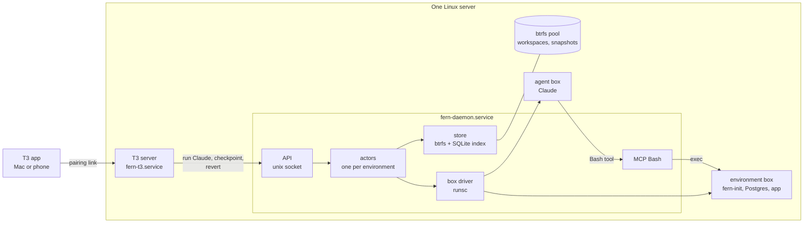
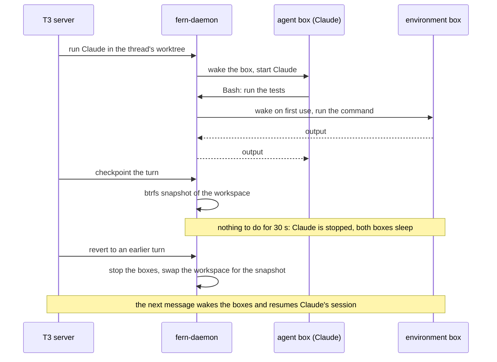

# Fern

[](https://github.com/nebler/fern/actions/workflows/ci.yml)


[](LICENSE)

**Give every AI coding thread its own environment that behaves like git for everything: code, dependencies and the running database.**

Fern runs behind [T3 Code](https://github.com/pingdotgg/t3code). Each thread gets a sandboxed box with its own copy of the repository and its services (such as Postgres). Every agent turn is snapshotted, so reverting a thread in T3 brings back the files *and* the database as they were. Idle boxes sleep and wake on the next message. Claude runs as the real `claude` CLI on your own subscription: no API keys.

## How it works



- **The daemon** (`fern-daemon`) owns the environments. Each one has an **actor**, a goroutine that makes its changes one at a time, counts the commands running in its boxes and puts them to sleep when idle.
- **The store** keeps each workspace as a btrfs subvolume. A snapshot is a btrfs snapshot (milliseconds, no copy), and a revert swaps the workspace for a copy of one in a single atomic rename. SQLite is only the index: the disk is the truth.
- **Boxes** are [gVisor](https://gvisor.dev) sandboxes the daemon starts itself with `runsc`, each with its own network namespace, an nftables firewall (internet only) and cgroup limits. Claude runs in an **agent box** of its own; its shell commands go through the daemon to the **environment box**, where the services are. The environment box never sees Claude's login.
- **Golden snapshots** hold a repository's built setup (installed dependencies, an initialised database), so a new thread starts from one instead of running setup again.

A turn, end to end:



## Results

Measured on the VPS, median of 3 runs: the current design against the first v2 design (agent-sandbox pods on Kubernetes).

| | first design | now | |
|---|---:|---:|---:|
| CPU per short agent turn | 62,434 ms | 7,188 ms | **8.7× less** |
| wake, p50 | 993 ms | 253 ms | 3.9× faster |
| sleep, p50 | 1,221 ms | 90 ms | 13.6× faster |
| revert in T3 (restore) | 1,034 ms | 108 ms | 9.6× faster |
| memory per box, 20 awake | 82.8 MiB | 45.2 MiB | 45% less |

Every number and how it was measured is in [`lab/RESULTS.md`](lab/RESULTS.md).

## Engineering

- **Crash-safe by construction.** Every multi-step change leaves the disk showing how far it got (a marker file, a copy beside the workspace, a snapshot without its row), and `Reconcile` finishes or clears it on start. Crash tests stop each change at every one of its steps, on a real btrfs filesystem in CI.
- **Actors, tested with a fake clock.** One goroutine per environment, talked to through its mailbox. Idle sleeps, pre-wakes and concurrent changes are tested in `testing/synctest` bubbles, with `goleak` checking for leaked goroutines.
- **Performance is gated.** `lab/perf.sh` fails a change that makes any of its 288 metrics worse than the baseline (time, CPU, memory, disk and network). `lab/ab.sh` runs two versions in alternation on the same machine and gives each metric's change with a 95% interval and a p-value. `lab/profile.sh` traces an operation with OpenTelemetry and draws flamegraphs of the whole node.
- **Typed SQL.** The index's queries are plain SQL; [sqlc](https://sqlc.dev) generates the Go for them.
- **Sandboxing in depth.** gVisor, no capabilities, a read-only root, the repository's git folder mounted read-only, a firewall that allows only the internet, and the login kept out of every box that runs the repository's code. Threat model: [`docs/briefs/claude-outside-the-box.md`](docs/briefs/claude-outside-the-box.md).

## Try it

You need Docker, bash 5 (on a Mac: `brew install bash`), a Claude subscription and the T3 app.

```sh
lab/setup.sh                    # a local lab: a systemd Linux node in Docker
FERN_HOST=1.2.3.4 lab/setup.sh  # or a VPS, as root over SSH
```

It builds the images, starts the node with the daemon and T3's server, asks once for your Claude login (`claude setup-token`), runs the quick checks and prints a pairing link. In the T3 app, open Settings → Connections, paste the link, and start a thread in **New worktree**.

After a change: `lab/dev.sh` runs the unit tests, builds and runs the quick integration checks (about 3 minutes). [AGENTS.md](AGENTS.md) lists every command.

## Repository

| | |
|---|---|
| [`cmd/fern-daemon`](cmd/fern-daemon) | the daemon: wiring only |
| [`cmd/fern-init`](cmd/fern-init) | a box's main process: runs the services, serves exec |
| [`cmd/fern`](cmd/fern) | the CLI |
| [`internal/actor`](internal/actor) | one actor per environment, idle sleep, golden builds |
| [`internal/store`](internal/store) | the btrfs pool, snapshots, retention, `Reconcile` |
| [`internal/runsc`](internal/runsc) | boxes as gVisor sandboxes: bundle, network, firewall |
| [`internal/boxexec`](internal/boxexec) | the exec protocol over WebSocket |
| [`internal/hibernate`](internal/hibernate) | stops an idle Claude and resumes it unseen |
| [`internal/api`](internal/api) | the daemon's HTTP API on a unix socket, and its client |
| [`lab`](lab) | the lab, integration checks, perf gate, A/B and profiler |
| [`docs`](docs) | architecture, design, roadmap and decision briefs |

## Status

Built and measured on a VPS: environments, snapshots per turn, revert, golden snapshots, idle sleep and wake, pre-wake, agent boxes, and the T3 integration (T3 patches in [`images/t3`](images/t3)). Next: forking a thread's environment, and a warm pool of boxes for faster first wakes.

Fern v1, a control plane for coding-agent jobs in disposable containers, is at tag [`v1-final`](https://github.com/nebler/fern/tree/v1-final).

## License

[MIT](LICENSE)
